# Heart Disease Exploratory Data Analysis

**A clear, notebook-based exploration of heart disease data—from initial checks to a cleaned, encoded, and scaled feature table.**

  

---

## Project at a glance

| | |
|---|---|
| **Dataset** | 918 records · 11 input features |
| **Target** | `HeartDisease` · 0 = no heart disease · 1 = heart disease |
| **Tools** | Python · pandas · NumPy · Seaborn · Matplotlib · scikit-learn |
| **Main output** | Cleaned, one-hot encoded, scaled feature table in `data_encode` |
| **Notebook** | [`heart_disease_eda.ipynb`](heart_disease_eda.ipynb) |

**Scope:** This project covers exploratory analysis and preprocessing. It does not train or evaluate a model; the findings describe this dataset and are not clinical guidance.

---

## Key takeaways

- **Target labels:** 410 records are labeled 0 and 508 are labeled 1 (44.7% vs. 55.3%).
- **Data quality:** 172 Cholesterol readings and one RestingBP reading are zero. Mean replacement removes the zero readings; for Cholesterol, assigning the same mean to all 172 records creates a visible spike.
- **Category patterns:** 79% of records in the ASY chest-pain category and 79% of records with `FastingBS = 1` have target label 1 in this sample. These are descriptive within-category shares, not personal risk estimates.
- **Numeric patterns:** Median age is 57 for label 1 and 51 for label 0. Oldpeak and MaxHR have the strongest linear correlations with the target in the numeric heatmap (about +0.40 and −0.40).

---

## Analysis workflow

~~~mermaid
flowchart LR
    A[heart.csv] --> B[Inspect and summarize]
    B --> C[Explore distributions and target patterns]
    C --> D[Review zero-valued measurements]
    D --> E[Replace zero Cholesterol and RestingBP readings]
    E --> F[One-hot encode categorical features]
    F --> G[Scale selected numeric features]
    G --> H[Prepared data_encode table]
~~~

---

## Before-and-after data cleaning

The plots place the original zero-affected distribution on the left and the cleaned distribution on the right.

### Cholesterol

<table>
  <tr>
    <th>Before · zero readings present</th>
    <th>After · zero readings replaced</th>
  </tr>
  <tr>
    <td>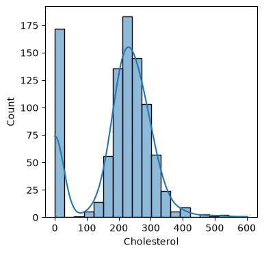</td>
    <td>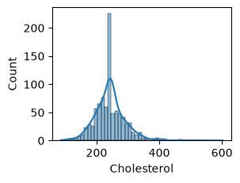</td>
  </tr>
</table>

**Interpretation:** 172 of 918 readings (18.7%) are zero. After replacing them with the non-zero mean (**244.64**), the zero spike disappears and a new spike forms at the mean because every affected row receives the same value. This simple imputation can understate variability.

### Resting blood pressure

<table>
  <tr>
    <th>Before · zero reading present</th>
    <th>After · zero reading replaced</th>
  </tr>
  <tr>
    <td>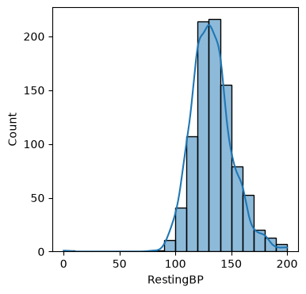</td>
    <td>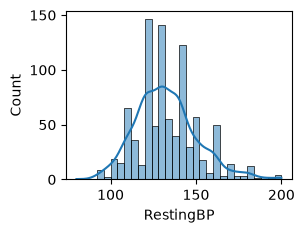</td>
  </tr>
</table>

**Interpretation:** One of 918 readings is zero. It is replaced with the non-zero mean (**132.54 mmHg**), so the overall distribution changes very little. The plots use different histogram bins and vertical scales; compare their shape rather than individual bar heights.

---

## More charts and interpretations

<strong>Open the other 10 notebook charts</strong>

### Target-label distribution

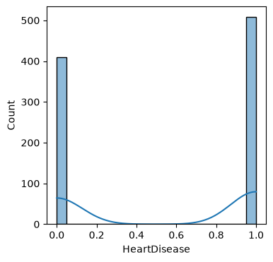

**Interpretation:** There are 508 positive and 410 negative labels. Read the bars for this binary target; the KDE curve is not meaningful here.

### Age distribution

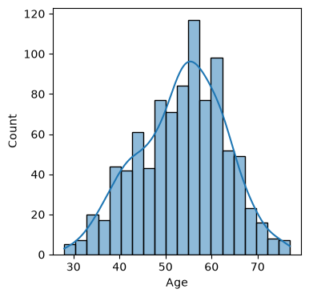

**Interpretation:** Median age is 54 years, and the middle half of records falls between 47 and 60 years.

### Chest pain type by target label

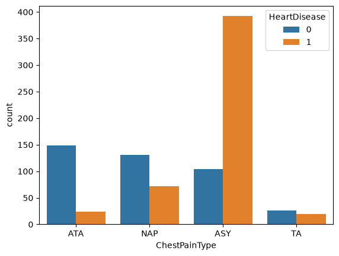

**Interpretation:** ASY has 392 positive labels among 496 records (79%); ATA has 149 negative labels among 173 records (86%). NAP and TA are less separated. These are sample-specific shares, not causal findings.

### Numeric feature correlation heatmap

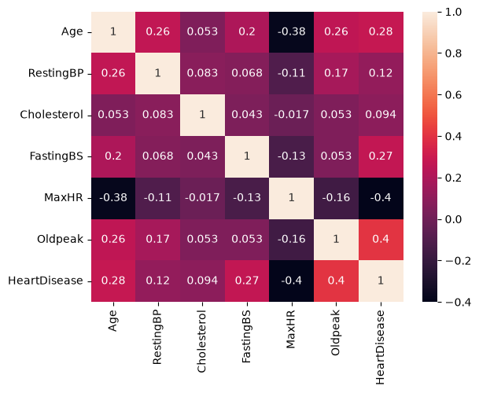

**Interpretation:** Oldpeak and MaxHR have the strongest linear correlations with `HeartDisease` in this matrix (about +0.40 and −0.40). Cholesterol is weak (about +0.09). Correlation alone does not establish causation or predictive value.

### Numeric feature distributions

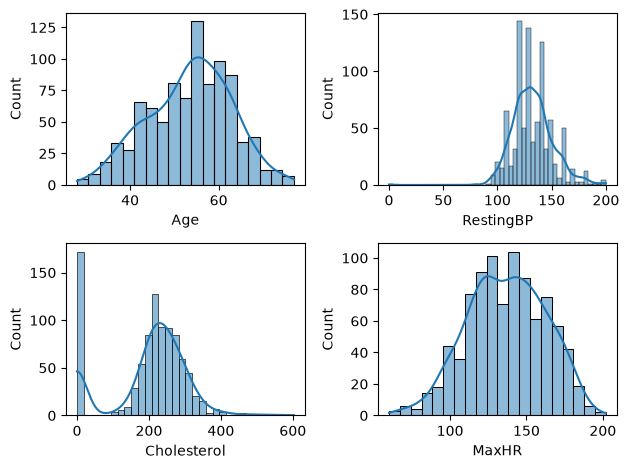

**Interpretation:** The panel reveals the zero-value spikes in Cholesterol and RestingBP. Age and MaxHR are broadly centered in their observed ranges.

### Maximum heart rate distribution

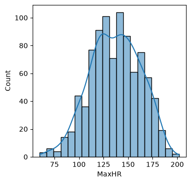

**Interpretation:** Median MaxHR is 138 bpm, and the middle half of observations falls between 120 and 156 bpm. This plot is not split by target label.

### Sex by target label

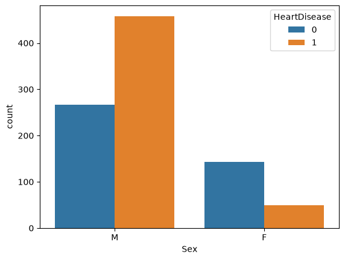

**Interpretation:** Positive labels occur in 458 of 725 male records (63%) and 50 of 193 female records (26%). The group sizes differ, so compare within-group shares rather than raw counts alone.

### Fasting blood sugar by target label

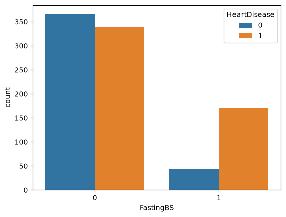

**Interpretation:** Positive labels occur in 170 of 214 records with `FastingBS = 1` (79%) and 338 of 704 with `FastingBS = 0` (48%). This is a descriptive association in this sample, not evidence of cause.

### Cholesterol by target label

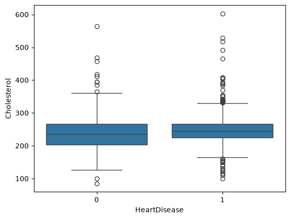

**Interpretation:** Median Cholesterol is 244.64 for label 1 and 235 for label 0, but the middle ranges overlap substantially. The imputed values also affect the label-1 distribution.

### Age by target label

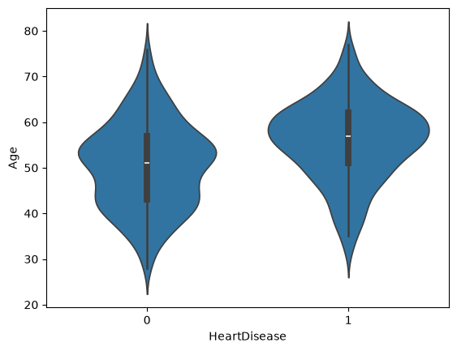

**Interpretation:** Median age is 57 for label 1 and 51 for label 0. The distributions overlap, so age shows a group-level difference rather than a clean separation.

---

## Reproduce the analysis

Use Python 3.10 or newer.

~~~bash
git clone https://github.com/AnmolMittal115/heart-disease-exploratory-data-analysis.git
cd heart-disease-exploratory-data-analysis
python -m venv .venv
~~~

Activate the environment:

~~~powershell
.venv\Scripts\Activate.ps1
~~~

On macOS or Linux, run `source .venv/bin/activate`. Then install the packages and open the notebook:

~~~bash
python -m pip install -r requirements.txt
jupyter notebook heart_disease_eda.ipynb
~~~

Run the notebook cells from top to bottom; `heart.csv` is loaded from the repository root.

---

## Repository contents

~~~text
heart-disease-exploratory-data-analysis/
├── heart_disease_eda.ipynb
├── heart.csv
├── requirements.txt
├── images/                 # Notebook chart exports
└── README.md
~~~

## Dataset source

The CSV follows the **Heart Failure Prediction** dataset schema published by [fedesoriano on Kaggle](https://www.kaggle.com/datasets/fedesoriano/heart-failure-prediction).

---

## Project scope

This is an exploratory data analysis and preprocessing project. It does not train or evaluate a classifier. If modeling is added later, split the data first and fit preprocessing steps on the training set only to avoid data leakage.
