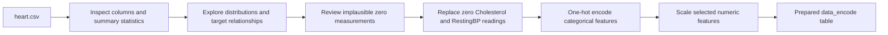

<div align="center">

# Heart Disease Exploratory Analysis

**A notebook-based exploration of heart disease data, from first look to a cleaned and scaled feature table.**

[](https://www.python.org/)
[](https://jupyter.org/)
[](#project-scope)

</div>

---

## Why this project

This project uses Python to explore a public heart disease dataset, visualize patterns across clinical and demographic features, and prepare the data for a future modeling step. It focuses on making the data easier to inspect and understand before any predictive model is considered.

> **Project scope:** this repository contains exploratory data analysis and preprocessing. It does not train or evaluate a classifier, and its charts are descriptive rather than clinical guidance.

## At a glance

| | |
|---|---|
| **Records** | 918 |
| **Input features** | 11 |
| **Target** | `HeartDisease` (0 = no heart disease, 1 = heart disease) |
| **Target counts** | 410 labeled 0 · 508 labeled 1 |
| **Tools** | Python · pandas · NumPy · Seaborn · Matplotlib · scikit-learn |
| **Main artifact** | `heart_disease_eda.ipynb` |

## Analysis flow



The notebook replaces 172 zero Cholesterol readings with the non-zero mean and replaces one zero RestingBP reading with its non-zero mean. It then one-hot encodes categorical columns and scales the selected numeric columns. The original CSV is included so the analysis can be reproduced.

## A look at the data

<table>
  <tr>
    <td align="center"><strong>Target label distribution</strong><br></td>
    <td align="center"><strong>Age distribution</strong><br></td>
  </tr>
  <tr>
    <td align="center"><strong>Chest pain type by target label</strong><br></td>
    <td align="center"><strong>Numeric feature correlation heatmap</strong><br></td>
  </tr>
</table>

## Zero-value cleanup: before and after

These paired plots make the data-cleaning step easy to compare: the original distributions with zero readings are on the left, and the distributions after replacing those readings with the non-zero mean are on the right.

### Cholesterol

<table>
  <tr>
    <th>Before cleaning · zero readings present</th>
    <th>After cleaning · zero readings replaced</th>
  </tr>
  <tr>
    <td></td>
    <td></td>
  </tr>
</table>

### Resting blood pressure

<table>
  <tr>
    <th>Before cleaning · zero reading present</th>
    <th>After cleaning · zero reading replaced</th>
  </tr>
  <tr>
    <td></td>
    <td></td>
  </tr>
</table>

<details>
<summary><strong>Browse the other 6 notebook charts</strong></summary>

| Visualization | Preview |
|---|---|
| Numeric feature distributions |  |
| Maximum heart rate distribution |  |
| Sex by target label |  |
| Fasting blood sugar by target label |  |
| Cholesterol by target label |  |
| Age by target label |  |

</details>

## What the notebook covers

- Initial inspection, summary statistics, and feature types
- Univariate distributions for numeric variables
- Count plots and grouped plots for categorical and numeric variables
- A correlation heatmap for numeric features
- Review and treatment of zero values in Cholesterol and RestingBP
- One-hot encoding of categorical fields
- Standard scaling of selected numeric fields

If model training is added later, the data should be split first and the scaler fitted on training data only (for example, in a scikit-learn pipeline) to avoid leakage.

## Run it locally

You’ll need Python 3.10 or newer.

```bash
git clone https://github.com/AnmolMittal115/heart-disease-eda-cost-analysis.git
cd heart-disease-eda
python -m venv .venv
```

Activate the environment:

```powershell
.venv\Scripts\Activate.ps1
```

On macOS or Linux, use `source .venv/bin/activate`. Then install the dependencies and open the notebook:

```bash
python -m pip install -r requirements.txt
jupyter notebook heart_disease_eda.ipynb
```

Run the notebook cells from top to bottom. The CSV is read from the repository root.

## Repository contents

```text
heart-disease-eda/
├── heart_disease_eda.ipynb   # EDA and preprocessing walkthrough
├── heart.csv                 # Source dataset used by the notebook
├── requirements.txt          # Python dependencies
├── images/                   # Exported notebook charts for this README
└── README.md
```

## Dataset

The CSV follows the **Heart Failure Prediction** dataset schema published by [fedesoriano on Kaggle](https://www.kaggle.com/datasets/fedesoriano/heart-failure-prediction). It includes age, sex, chest pain type, blood pressure, cholesterol, fasting blood sugar, ECG results, maximum heart rate, exercise-induced angina, Oldpeak, ST slope, and the `HeartDisease` target.

